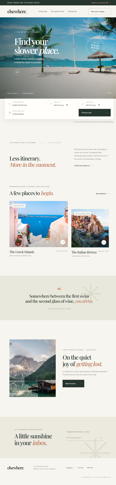

# Elsewhere

A responsive, editorial-style landing page for a thoughtfully curated travel-stay brand. Built with plain HTML, CSS, and JavaScript—no build step or dependencies required.

## Preview



## Run locally

Open `index.html` in a browser, or start a local server from this folder:

```bash
python -m http.server 8000
```

Then visit [http://localhost:8000](http://localhost:8000).

## Files

- `index.html` — semantic page structure and content
- `styles.css` — responsive layout, typography, and visual styling
- `script.js` — mobile navigation, date validation, booking feedback, and newsletter interaction
- `screenshot.png` — full-page desktop preview

Photography is served by Unsplash; Google Fonts provides DM Sans and Playfair Display.
